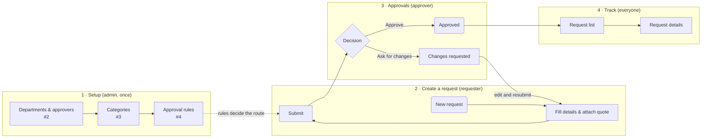

# Overview: how Requisio's features connect

| | |
|---|---|
| **Status** | Draft — made-up demo content |
| **Area** | All features |
| **Based on** | Issues #1, #5, #10, #14 · Use cases · Journey map |
| **Diagram type** | Flowchart |

**How to read it:** rounded rectangle = start or end · rectangle = a step · diamond = a decision · a **dashed border** means it is an assumption.

## What comes from the documents
- Four areas and who uses each (User understanding)
- Request → approval → tracking (Journey map)

## Assumptions
- Admins finish setup before the first request is raised

## Open questions
- Can requesters see the approval route before submitting? (#4 says yes)

## Decisions
_None yet._ When you change this flowchart yourself, add one line here: `date — what changed — who — why`
