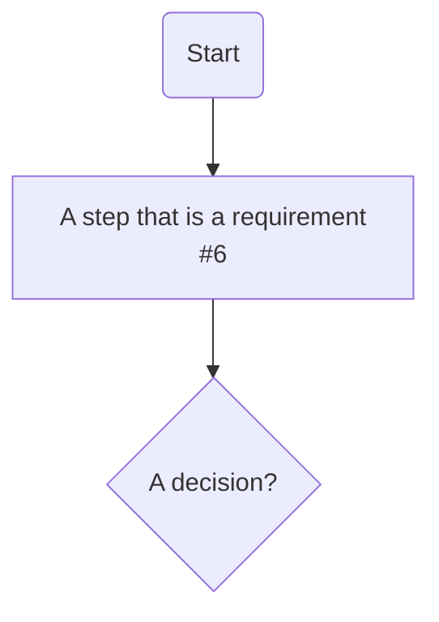

# Flowcharts

One file per flowchart. A feature can have more than one (for example Approvals has two).
The handbook shows each one in its feature's **Flowcharts** tab, with its description and open questions underneath.

## How to write a flowchart file

Copy this into a new `.md` file inside this folder (any sub-folder is fine):

````markdown
# Short name of the flow

| | |
|---|---|
| **Feature** | Create a purchase request (#5) |
| **Based on** | Issues #5, #6, #7 |
| **Diagram type** | Flowchart |



## Description
One or two sentences on what this flow shows.

## Open questions
- A question that still needs an answer

## Assumptions
- Something we believe but nobody has confirmed (shown as "Not confirmed yet")

## Decisions
_None yet._
````

**Rules the website relies on**
- **Feature** line: the feature's name and its issue number in brackets, e.g. `(#5)`. Use `Whole product` for the one flowchart of the whole product.
- Put a requirement's number in its box (`#6`). The website uses it to link the box to the requirement and to put that requirement's wireframe in the same order.
- **Description**, **Open questions** and **Assumptions** are optional. Leave them out if there is nothing to say.
- Created and last-updated dates come from GitHub's history automatically.

## Flowcharts in this project

| Flowchart | Feature |
|---|---|
| [Overview: how Requisio's features connect](00-overview.md) | Whole product |
| [Setup: approval rules](setup/approval-rules.md) | Setup (#1) |
| [Create request: new purchase request](create-request/new-request.md) | Create a purchase request (#5) |
| [Approvals: approve, reject or ask for changes](approvals/approve-reject.md) | Approve purchase requests (#10) |
| [Approvals: who talks to whom](approvals/approval-sequence.md) | Approve purchase requests (#10) |
| [Track: find a request and see its details](requests/find-and-view.md) | Track purchase requests (#14) |
