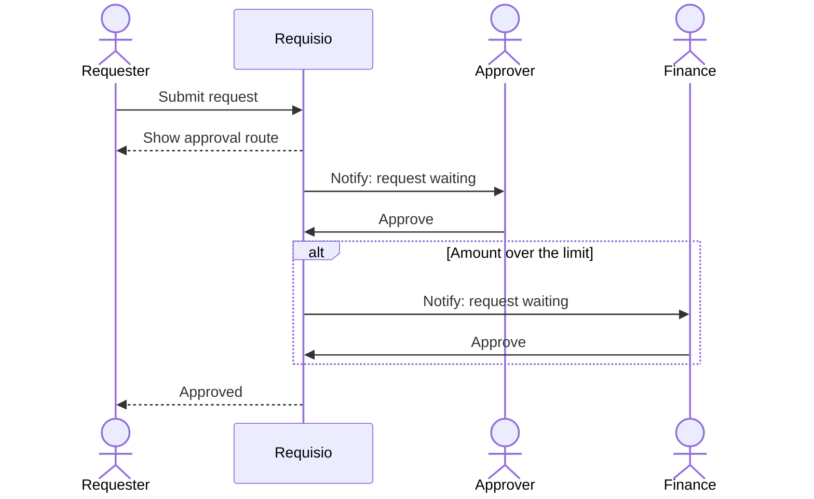

# Approvals: who talks to whom

| | |
|---|---|
| **Status** | Draft — made-up demo content |
| **Feature** | Approve purchase requests (#10) |
| **Based on** | Issues #9, #11, #12 · Journey map stages 4–6 |
| **Diagram type** | Sequence diagram |

**How to read it:** top to bottom, each arrow is one message between people or systems.

<!-- --8<-- [start:flow] -->

<!-- --8<-- [end:flow] -->

## Description
Who sends what to whom when a request is approved, including the extra Finance step above an amount.

## What comes from the documents
- Route shown on submit (#9)
- Extra approver above an amount (#4)

## Assumptions
- Finance approves after the first approver

## Open questions
- Is Finance always last?

## Decisions
_None yet._ When you change this flowchart yourself, add one line here: `date — what changed — who — why`
