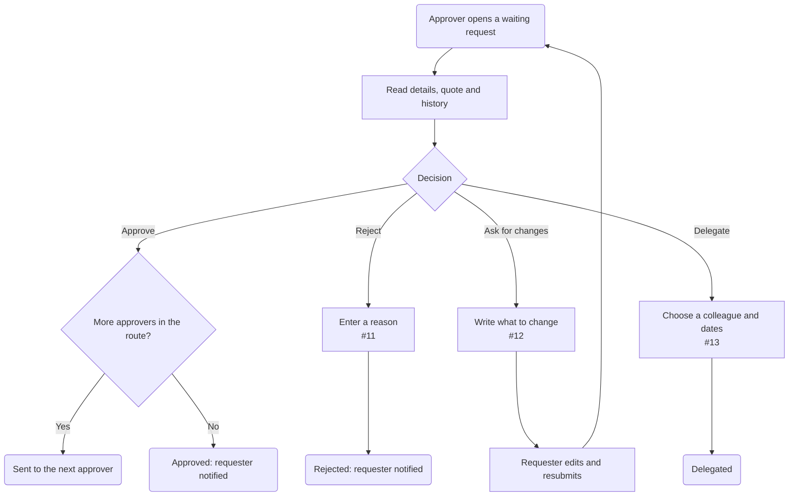

# Approvals: approve, reject or ask for changes

| | |
|---|---|
| **Status** | Draft — made-up demo content |
| **Area** | Approvals (#10) |
| **Based on** | Issues #10, #11, #12, #13 · Use cases 4–6 · Journey map stage 6 |
| **Diagram type** | Flowchart |

**How to read it:** rounded rectangle = start or end · rectangle = a step · diamond = a decision · a **dashed border** means it is an assumption.

<!-- --8<-- [start:flow] -->

<!-- --8<-- [end:flow] -->

## What comes from the documents
- Reject needs a reason (#11)
- Changes and resubmit keep history (#12)
- Delegation with dates (#13)

## Assumptions

## Open questions
- Do approvers decide one after another, or at the same time?

## Decisions
_None yet._ When you change this flowchart yourself, add one line here: `date — what changed — who — why`
