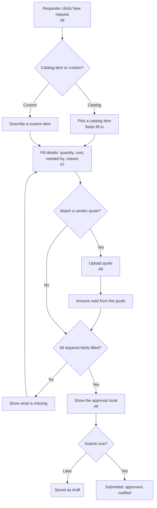

# Create request: new purchase request

| | |
|---|---|
| **Status** | Draft — made-up demo content |
| **Feature** | Create a purchase request (#5) |
| **Based on** | Issues #5, #6, #7, #8, #9 · Use cases 1–3 · Journey map stages 1–4 |
| **Diagram type** | Flowchart |

**How to read it:** rounded rectangle = start or end · rectangle = a step · diamond = a decision · a **dashed border** means it is an assumption.

<!-- --8<-- [start:flow] -->

<!-- --8<-- [end:flow] -->

## Description
How a requester raises a request: catalog or custom item, details, an optional quote, a check for missing fields, then submit or save as a draft.

## What comes from the documents
- Catalog vs custom items (Use cases 1–2)
- Quote upload with the amount read from it (#8)
- Route shown before submit (#9, journey map stage 4)

## Assumptions
- Requests can be saved as drafts

## Open questions
- Which file types are accepted for quotes?
- Can a catalog item's price be changed?

## Decisions
_None yet._ When you change this flowchart yourself, add one line here: `date — what changed — who — why`
