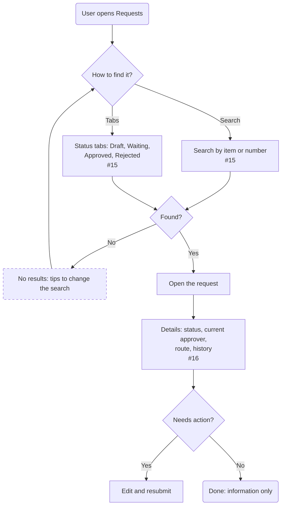

# Track: find a request and see its details

| | |
|---|---|
| **Status** | Draft — made-up demo content |
| **Area** | Request list & details (#14) |
| **Based on** | Issues #14, #15, #16 · Use cases 7–8 · Journey map stage 5 |
| **Diagram type** | Flowchart |

**How to read it:** rounded rectangle = start or end · rectangle = a step · diamond = a decision · a **dashed border** means it is an assumption.

## What comes from the documents
- Search, filters and status tabs (#15)
- Details with route and history (#16)

## Assumptions

## Open questions
- Should requesters see other people's requests?

## Decisions
_None yet._ When you change this flowchart yourself, add one line here: `date — what changed — who — why`
