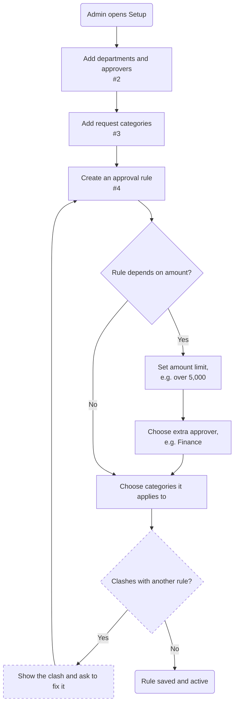

# Setup: approval rules

| | |
|---|---|
| **Status** | Draft — made-up demo content |
| **Area** | Setup (#1) |
| **Based on** | Issues #1, #2, #3, #4 · Use cases 9–11 |
| **Diagram type** | Flowchart |

**How to read it:** rounded rectangle = start or end · rectangle = a step · diamond = a decision · a **dashed border** means it is an assumption.

<!-- --8<-- [start:flow] -->

<!-- --8<-- [end:flow] -->

## What comes from the documents
- Departments, categories and rules by amount (#2, #3, #4)

## Assumptions
- The system checks for clashing rules

## Open questions
- If two rules match, which one wins?

## Decisions
_None yet._ When you change this flowchart yourself, add one line here: `date — what changed — who — why`
